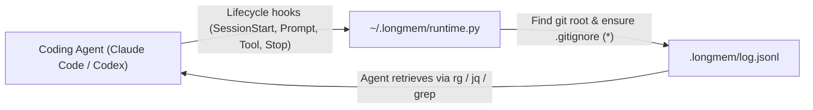

# LongMem (Python Edition)

**Durable, programmatic memory for coding agents.**

Long tasks outlive context windows. After compaction or a fresh session, coding agents lose earlier decisions, repeat failed work, and miss important tool outputs.

LongMem records coding-session events in a local, append-only JSONL log (`.longmem/log.jsonl`) and equips the agent with a skill for searching only the history it needs.

Works natively with **Claude Code** and **Codex**. Pure Python 3 (standard library only) with zero external dependencies.

---

## Key Features

- **Zero Dependencies**: Pure Python 3 standard library. No npm, no node, no heavy frameworks.
- **Global & Local Workflows**:
  - **Global Mode** (`longmem init --global`): Installs once into `~/.claude/` and `~/.codex/`. Every git repository or workspace automatically initializes its own isolated memory on session start.
  - **Local Mode** (`longmem init`): Explicitly initializes a single project repository.
- **Automatic Gitignore**: On `SessionStart`, LongMem initializes `.longmem/` at the root of the git repository and creates `.longmem/.gitignore` with `*` so all memory logs remain untracked by Git automatically.
- **Safe Coexistence**: Preserves existing hook configurations (such as `proshort`, `rtk`, or custom user hooks) and existing instructions in `CLAUDE.md` and `AGENTS.md`.
- **Anti-Recursion / Self-Read Filtering**: Reads of `.longmem/log.jsonl` are automatically excluded from recording, preventing memory queries from duplicating into the log.

---

## Quick Start

### 1. Run directly with `uv tool run` (Zero Installation)

`uv tool run` builds `longmem` from the GitHub repository in an isolated environment and runs it without requiring manual installation. Prefix any command with `uv tool run --from git+ssh://git@github.com/sercant/longmem`:

```bash
# Check version
uv tool run --from git+ssh://git@github.com/sercant/longmem longmem --version

# Initialize globally
uv tool run --from git+ssh://git@github.com/sercant/longmem longmem init --global

# Check global status
uv tool run --from git+ssh://git@github.com/sercant/longmem longmem status --global
```

To pin a branch, tag, or commit, append `@<ref>` to the URL, e.g. `git+ssh://git@github.com/sercant/longmem@develop`.

### 2. Or Install with uv / pip

```bash
# Install as a global CLI tool via uv
uv tool install git+ssh://git@github.com/sercant/longmem

# Or install editable from a local checkout
uv tool install --editable /path/to/longmem

# Or install in active virtualenv
pip install -e /path/to/longmem
```

After installation, run commands directly:

```bash
longmem init --global
longmem status --global
```

This:
1. Copies the standalone runtime to `~/.longmem/runtime.py`.
2. Registers lifecycle hooks in `~/.claude/settings.json` and `~/.codex/hooks.json`.
3. Injects retrieval instructions into `~/.claude/CLAUDE.md` and `~/.codex/AGENTS.md` (and `~/.agents/AGENTS.md`).
4. Installs the `longmem` skill into `~/.claude/skills/longmem/` and `~/.agents/skills/longmem/`.

### 3. Initialize Per-Project (Optional)

To initialize memory in only a specific project directory:

```bash
cd /path/to/project
longmem init
```

---

## How It Works



1. When a session begins, the `SessionStart` hook fires.
2. `runtime.py` resolves the git repository root (`git rev-parse --show-toplevel`).
3. It creates `<repo_root>/.longmem/` with `.gitignore` containing `*` and creates `log.jsonl`.
4. Subsequent prompts, tool executions, and assistant messages are recorded as JSON lines.
5. When prior context is needed, the agent searches `.longmem/log.jsonl` using normal shell tools (`rg`, `grep`, `jq`, Python) without loading whole transcripts into model context.

### Log Format

Each line in `.longmem/log.jsonl` is a self-contained JSON object:

```json
{
  "timestamp": "2026-09-16T02:23:00.123456Z",
  "client": "claude-code",
  "sessionId": "sess-abc123",
  "type": "user_prompt",
  "content": {
    "hook_event_name": "UserPromptSubmit",
    "prompt": "Migrate database schema to v2"
  }
}
```

Canonical event types:
- `session_start`
- `session_end`
- `user_prompt`
- `tool_call`
- `tool_result`
- `assistant_message`

---

## Retrieving History

The agent skill teaches models to search the log narrowly:

```bash
# Find when a file or decision was mentioned
rg -n 'migration|schema|failed' .longmem/log.jsonl

# Review recent session entries
tail -n 50 .longmem/log.jsonl

# Filter for tool execution results
jq -c 'select(.type == "tool_result")' .longmem/log.jsonl | tail -n 20
```

---

## CLI Reference

### `init`
```bash
# Global install (all repos)
longmem init --global

# Specify clients explicitly
longmem init --global --client claude-code,codex

# Local project install
longmem init --dir /path/to/project
```

### `status`
```bash
# Check global installation status
longmem status --global

# Check current project status
longmem status

# Output machine-readable JSON
longmem status --json
```

### `deinit` (alias: `uninstall`)
```bash
# Deinitialize globally (preserves logs)
uv tool run --from git+ssh://git@github.com/sercant/longmem longmem deinit --global
# or: longmem deinit --global

# Deinitialize globally and purge ~/.longmem
uv tool run --from git+ssh://git@github.com/sercant/longmem longmem deinit --global --purge

# Deinitialize from a specific project
uv tool run --from git+ssh://git@github.com/sercant/longmem longmem deinit --dir /path/to/project [--purge]
```

---

## Running Tests

Run the test suite with Python's built-in `unittest`:

```bash
python3 -m unittest discover -s tests -p "test_*.py" -v
```

---

## License

MIT
